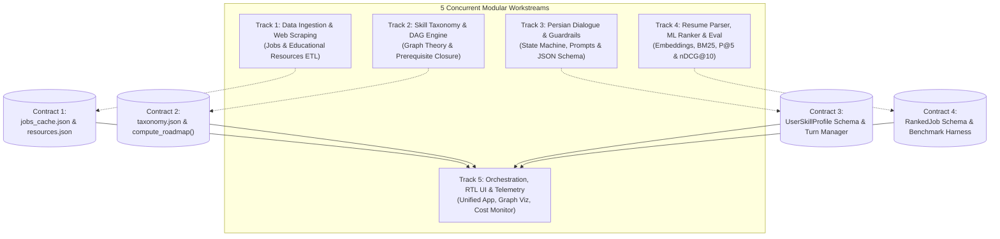

Here is the breakdown of the project into **5 modular, concurrent workstreams**. 

Each module defines a strict **Input/Output contract (Mock Interface)** so that all 5 tracks can be developed **in parallel from Minute 1** without blocking each other (e.g., the ML team does not wait for scraping to finish, and the UI team does not wait for model training).

---

### Step 1: Data Ingestion & Web Scraping Pipeline (Data Engineering)
*Can be developed independently by Team Member 1*

In a production environment, data is continuously crawled, normalized, and updated rather than hardcoded.

- **Production Tasks:**
  1. **Job Scraping & ETL:** Crawlers for Iranian job platforms (Jobinja, Quera, Jobvision) and global tech boards with rate limiting, polite delays, custom `User-Agent`, and `robots.txt` compliance.
  2. **Data Normalization & Cleaning:** Extract clean text, parse salaries, locations, work modes (Remote/Hybrid/On-site), and standardize requirements.
  3. **Deduplication Engine:** MinHash / Jaccard token similarity over job descriptions and `(company + title)` deduplication.
  4. **Educational Resource Harvester & Link Health Checker:** Scrape/catalog vetted courses and roadmaps (Quera College, Maktabkhooneh, Roadmap.sh, Coursera). Run an automated HTTP validator (`requests.head`) to eliminate 404s/broken links.
- **Contract / Mock Output (Available immediately for other tracks):**
  - `data/jobs_cache.json` ($\ge 50$ normalized job records).
  - `data/resources.json` (verified educational resources indexed by `concept_id`).

---

### Step 2: Knowledge Graph & Deterministic DAG Engine (Graph Engineering)
*Can be developed independently by Team Member 2*

Completely independent of LLMs and UI. Solves the core RFP requirement of mathematical determinism and zero-hallucination paths.

- **Production Tasks:**
  1. **Taxonomy Modeling:** Define $\ge 10$ roles across 3 domains (Software, Data/AI, Business) with Junior, Mid, and Senior concept requirements.
  2. **DAG Integrity & Cycle Detector:** Implement graph validation using `networkx.is_directed_acyclic_graph`. Boot-time unit tests to prevent circular dependencies.
  3. **Deterministic Roadmap Engine:**
     - Computes prerequisite closure: $C_{\text{target}} \cup \text{Prerequisites}(C_{\text{target}})$.
     - Prunes validated user knowledge: $C_{\text{to\_learn}} = C_{\text{target\_closure}} \setminus C_{\text{known}}$.
     - Computes valid pedagogical order using `topological_sort`.
  4. **Dynamic Delta Updates:** Fast state transition if the user corrects their knowledge (e.g. removing/adding a node and re-sorting in $<10\text{ ms}$).
- **Contract / Mock Output:**
  - `taxonomy.json` schema.
  - Python interface: `compute_roadmap(role: str, target_level: str, known_concepts: list[str]) -> RoadmapResult`.

---

### Step 3: Persian Conversational Agent & Extraction Guardrails (Dialogue AI)
*Can be developed independently by Team Member 3*

Focuses on prompt engineering, dialogue turn management, and anti-hallucination Pydantic guardrails.

- **Production Tasks:**
  1. **Dialogue State Machine:** Enforces the $\le 6$-turn assessment limit (Role $\rightarrow$ Seniority $\rightarrow$ Education $\rightarrow$ Experience $\rightarrow$ Tools/Skills $\rightarrow$ Final Confirmation).
  2. **Persian NLP Preprocessing:** Persian text normalization (`hazm` / `persian_tools` for half-space `نیم‌فاصله` and character unification).
  3. **Structured JSON Profile Extraction:** Forces model outputs into typed Pydantic models (`target_role`, `target_level`, `known_concepts`).
  4. **Hallucination Pruning Layer:** Cross-checks extracted concepts against `taxonomy.json`. Discards or flags any concept not part of the verified ontology.
  5. **Conversational Summarizer (A-09):** Generates Persian explanations strictly bounded by the DAG output nodes.
- **Contract / Mock Output:**
  - Python interface: `ConversationManager.handle_user_turn(session_id, user_text) -> TurnResponse(message, is_complete, profile_json)`.

---

### Step 4: Resume Parsing, Hybrid Vector Ranking & Quantitative ML Benchmark (ML & IR)
*Can be developed independently by Team Member 4*

Handles document ingestion, vector retrieval, cross-encoder scoring, and the mandatory ML evaluation benchmark.

- **Production Tasks:**
  1. **Multi-Format Resume Parser:** In-memory extraction of `.pdf` and `.docx` (via `pdfplumber` / `python-docx`), extracting skills, YOE, and roles.
  2. **Hybrid Search Pipeline:**
     - **Dense Retriever:** Computes embeddings (`text-embedding-3-small`) for resumes and jobs; cosine similarity.
     - **Sparse Lexical Retriever:** BM25 (`rank-bm25`) on normalized technical tokens.
     - **Fusion:** Reciprocal Rank Fusion (RRF) or weighted hybrid score: $\alpha \cdot S_{\text{dense}} + (1-\alpha) \cdot S_{\text{bm25}}$.
  3. **Explainability Engine:** Identifies exact overlap (`matched_skills`) vs deficiencies (`missing_skills`).
  4. **Automated ML Benchmark Harness (`eval/evaluate_ranking.py`):**
     - Runs 3 synthetic ground-truth resumes against $\ge 20$ labeled job postings.
     - Generates quantitative comparison tables: **Precision@5** and **nDCG@10** for Baseline (Keyword/Jaccard) vs BM25 vs Proposed Hybrid.
- **Contract / Mock Output:**
  - Python interface: `rank_jobs(resume_text: str, filters: dict) -> list[RankedJob]`.
  - Eval script generating benchmark table for the jury report.

---

### Step 5: Application Orchestration, RTL Presentation & Production Telemetry (Integration & Full-Stack)
*Can be developed independently by Team Member 5 (or shared as modules finish)*

Assembles the components, delivers the Persian UX, and implements bonus capabilities.

- **Production Tasks:**
  1. **RTL Persian Interface:** Streamlit app with custom RTL CSS (`dir="rtl"`, Vazirmatn font) containing:
     - Tab 1: Persian Interactive Career Chatbot.
     - Tab 2: Interactive Single-Screen DAG Roadmap Viewer (Pyvis / Graphviz / Cytoscape).
     - Tab 3: Resume Upload, Job Matching Cards, and Filters.
  2. **Module B $\rightarrow$ Module A Bridge (Bonus B-10):** "Generate Roadmap for Missing Skills" button on each job card that directly feeds missing skills into the Step 2 DAG engine.
  3. **Voice Interaction (Bonus A-10):** Audio record widget $\rightarrow$ Whisper Persian STT $\rightarrow$ Agent $\rightarrow$ Persian TTS audio player.
  4. **Production Telemetry & Cost Dashboard (NF-05):** Real-time counter of prompt/completion tokens and estimated USD/Credit usage per session.
  5. **Single-Command Containerization (NF-07):** `Dockerfile` and `docker-compose.yml` (or `run.sh`) to start the entire system with zero configuration.

---

### Parallel Execution Schedule for Hackathon Day

| Time Window | Track 1 (Data) | Track 2 (Graph) | Track 3 (Dialogue) | Track 4 (ML & IR) | Track 5 (App/UI) |
| :--- | :--- | :--- | :--- | :--- | :--- |
| **09:30 - 11:00** | Scrape & cache 50+ jobs; build `resources.json` | Design 10 roles in `taxonomy.json`; build DAG validator | Prompt engineering & state machine ($\le 6$ Qs) | PDF/DOCX parser; generate job embeddings | Scaffold RTL Streamlit layout & mock tabs |
| **11:00 - 13:00** | De-duplicate & clean jobs dataset | Implement topological sort & delta updates | Pydantic JSON validation & Persian tests | Build Hybrid ranker (BM25 + Dense) | Integrate DAG Graph visualizer with Track 2 mock |
| **13:00 - 13:45** | *Lunch Break* | *Lunch Break* | *Lunch Break* | *Lunch Break* | *Lunch Break* |
| **13:45 - 15:30** | Verify links; final cache freeze | Connect to Track 3 output | Test full conversational flow with guardrails | Run benchmark script (P@5 & nDCG@10) | Plug real Track 1, 2, 3, 4 into UI |
| **15:30 - 16:30** | Assist with evaluation report | Assist with bonus features | Polish Persian prompt tone | Export eval tables for presentation | Add Voice STT/TTS + Cost dashboard |
| **16:30** | **Code Freeze & Deliverable Packaging (Code, README, Technical Report, Presentation PDF)** |

Would you like to begin with **Step 1 & Step 2** (generating the 10-role DAG taxonomy and the 50+ normalized job dataset)?